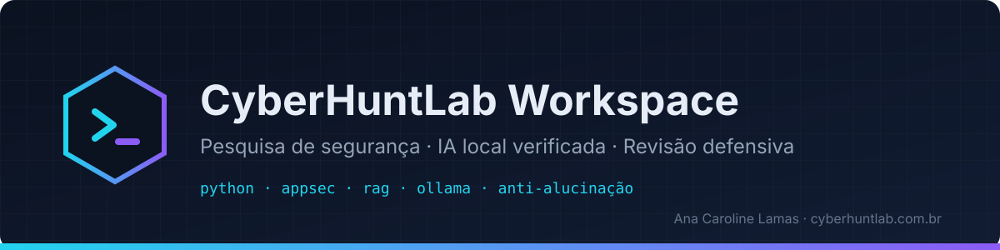

<p align="center"></p>

# CyberHuntLab Workspace v0.2 + Cyber Hunt AI

<!-- vercel-demo:start -->
<p align="center"><a href="https://cyberhunt-workspace-v0-2.vercel.app"></a></p>
<!-- vercel-demo:end -->

Ambiente independente de pesquisa de segurança, revisão defensiva de código e aprendizado. Sem afiliação ao Google.

A versão 0.2 preserva o workspace original (scanner, fontes, patch & relatório, gerador de perguntas) e acrescenta a **Cyber Hunt AI**: área de estudo privada com um modelo de linguagem de pesos abertos rodando na sua VPS, **sem API comercial de IA**, com verificação anti-alucinação independente do modelo.

```
Navegador ──> Vercel (estático + /api/auth + /api/ai) ──HTTPS + Bearer──> VPS: Caddy ─> API Python ─> Ollama (127.0.0.1)
                 senha scrypt, cookie HMAC                                   SQLite: memória, RAG, conversas
                 token da VPS só aqui                                        whisper.cpp · Piper · Tesseract
```

Detalhes em [docs/ARQUITETURA.md](docs/ARQUITETURA.md) e [docs/ANTI-ALUCINACAO.md](docs/ANTI-ALUCINACAO.md).

## Situação de cada funcionalidade

| Funcionalidade | Situação |
|---|---|
| Scanner heurístico original (7 regras) e demais abas originais | Implementado, preservado, testado |
| Login real (scrypt + cookie HttpOnly/Secure/SameSite assinado) | Implementado, testado |
| Proxy Vercel → VPS com lista de rotas permitidas; token só no backend | Implementado, testado |
| API privada na VPS (Starlette/Uvicorn) com Bearer token | Implementado, testado subindo o servidor real |
| Provedores locais Ollama e llama.cpp | Implementado; **não testado contra um modelo real** (sem rede neste ambiente para baixar modelos) |
| RAG: ingestão com procedência (URL, coleção, SHA-256, HTTP, data), BM25 + embeddings opcionais | Implementado, testado (BM25); embeddings não testados com modelo real |
| Verificador independente: CVE (CVE Services), GHSA (OSV), commits (GitHub), CWE (catálogo), URLs | Implementado, testado com respostas HTTP simuladas; chamadas reais não testadas aqui |
| Validação frase a frase com 8 rótulos (VERIFIED … CONTRADICTED) | Implementado, testado |
| Laço de reparo quando há identificador refutado ou citação fabricada | Implementado, testado |
| Abstenção nos modos Research/Evidence/Policy sem fontes | Implementado, testado |
| Detecção de prompt injection em documentos e código | Implementado (heurístico), testado |
| Proteção SSRF nos downloads | Implementado, testado |
| Memória persistente por categoria; sugestões só com confirmação; editar/exportar/excluir | Implementado, testado |
| Feedback → memória de correções → presente em todas as respostas seguintes | Implementado, testado |
| Trilhas de estudo que só avançam com evidência | Implementado, testado |
| Perguntas paralelas sem perder o contexto principal | Implementado, testado |
| 11 modos de operação com system prompts versionados | Implementado; qualidade depende do modelo escolhido |
| Integração scanner → IA (código + alertas reais como fonte) | Implementado, testado |
| Transcrição de voz (whisper.cpp / faster-whisper) | Implementado; **não testado** (binário e modelo não instalados aqui). Sem eles, a interface desativa o microfone |
| Resposta falada (Piper) | Implementado; **não testado** (idem) |
| OCR de imagens (Tesseract) | Implementado; Tesseract presente aqui, rota exercitada só no caminho de erro |
| Interpretação de imagens por modelo de visão | Implementado; **não testado**. Só ativa se o modelo declarar capacidade `vision` |
| Suíte de 11 avaliações anti-alucinação + benchmark de modelos | Implementado; pontuação testada; **ainda não executada contra um modelo real** |
| Exportação de dataset para fine-tuning futuro (JSONL) | Implementado, testado. **Nenhum treino foi feito** |
| Renderização visual de diagramas Mermaid | Planejado (hoje aparece como código) |
| Integrações Semgrep, CodeQL, Bandit, OSV-Scanner, Trivy, Gitleaks, sanitizadores | Planejado |
| Importador com procedência de arquivos de repositórios, Patch Explorer lado a lado, CWE Encyclopedia navegável, Evidence Gate de pesquisas | Planejado (especificação do prompt anterior; fora do escopo desta entrega) |

## Testes

```bash
npm test               # 17 testes Node: scanner, autenticação, proxy, lógica da interface
npm run test:py        # 43 testes Python: verificação, RAG, memória, orquestrador, API real via uvicorn
python3 tests/e2e/run_e2e.py   # navegador real -> dev-server -> API Python -> stub do Ollama (requer playwright)
```

O teste E2E usa `tests/e2e/ollama_stub.py`, que devolve texto fixo para exercitar a interface e o pipeline de verificação. Ele **não é um modelo** e não existe no produto.

## Implantação

### 1. VPS
```bash
scp -r cyberhunt-workspace usuario@vps:/tmp/
ssh usuario@vps 'sudo bash /tmp/cyberhunt-workspace/vps/deploy/install.sh'
bash /opt/cyberhunt-ai/vps/scripts/check_hardware.sh        # hardware real
ollama pull qwen3:4b && ollama pull gemma3:4b               # candidatos (confirme os nomes em ollama.com/library)
chai-run -m scripts.benchmark_models qwen3:4b gemma3:4b     # escolha pelos números
sudo nano /etc/cyberhunt-ai.env                             # CHAI_MODEL_* e demais variáveis
sudo systemctl restart cyberhunt-ai
chai-run -m scripts.ingest_sources ../knowledge/sources.json
chai-run -m cyberhunt_ai.evaluations.runner                 # avaliação anti-alucinação do modelo escolhido
```
Em ~8 GB de RAM sem GPU, comece com **um** modelo de 3–4B quantizado por vez (`OLLAMA_MAX_LOADED_MODELS=1`, já configurado). Respostas em CPU levam de alguns segundos a mais de um minuto.

Catálogo CWE completo: baixe `cwec_latest.xml.zip` em https://cwe.mitre.org/data/downloads.html e rode `chai-run -m scripts.import_cwe cwec_vX.xml /var/lib/cyberhunt-ai/cwe_catalog.json`.

Voz (opcional): compile whisper.cpp e baixe um modelo `ggml-small.bin`; instale Piper e uma voz pt_BR `.onnx`; ajuste os caminhos `CHAI_WHISPER_*` e `CHAI_PIPER_*`.

### 2. Vercel
1. `node scripts/hash-password.mjs` → gera `AUTH_PASSWORD_HASH` e `SESSION_SECRET`.
2. Variáveis no projeto Vercel: `AUTH_PASSWORD_HASH`, `SESSION_SECRET`, `VPS_URL` (ex.: `https://ai.cyberhuntlab.com.br`), `VPS_TOKEN` (o `CHAI_API_TOKEN` da VPS).
3. Framework Preset: **Other**; Build Command e Output Directory **vazios** (o `vercel.json` já define). `.vercelignore` impede publicar `vps/`, `tests/` e `scripts/`.
   Sem as variáveis, o site e o scanner funcionam e a aba Cyber Hunt AI mostra a lista do que falta configurar.
4. O limite de corpo das funções do Vercel (~4,5 MB) limita uploads; `maxDuration` de 300 s depende do seu plano.

### Desenvolvimento local
```bash
VPS_URL=http://127.0.0.1:8765 VPS_TOKEN=... SESSION_SECRET=... AUTH_PASSWORD_HASH=... node scripts/dev-server.mjs
```

## Princípios
- Nenhuma resposta substituta quando o modelo está fora do ar: a interface mostra o erro.
- Alerta heurístico não é vulnerabilidade; a IA é instruída e verificada nesse ponto.
- O modelo não executa comandos, não envia relatórios e não grava memória sozinho.
- Informações pessoais sensíveis não estão no system prompt; se quiser que a IA as considere, registre-as você mesma na Memória (privada, exportável, excluível).
- Não use para testar sistemas sem autorização. Revise as regras oficiais de cada programa antes de qualquer pesquisa.
