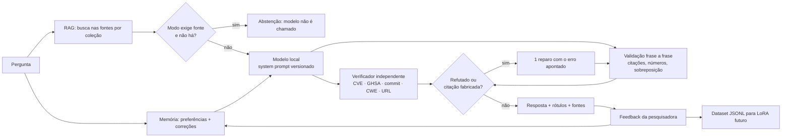

# Como a Cyber Hunt AI é "treinada" contra alucinação

## O que não foi feito, e por quê

Nenhum modelo foi treinado ou ajustado (fine-tuning) nesta entrega. Treinar exige GPU, centenas a milhares de exemplos revisados e avaliação antes/depois. Dizer que o modelo "foi treinado" porque recebeu documentos ou instruções seria falso.

Também não existe técnica que elimine alucinações. O objetivo é **detectar, rotular e reduzir**, e tornar visível o que não foi verificado.

## O que foi feito: especialização em camadas

| Camada | Arquivo | Efeito |
|---|---|---|
| System prompt versionado | `specialists/prompts.py` | Protocolo de citação [S#], marcações [INFERÊNCIA]/[HIPÓTESE]/[DESCONHECIDO], proibição de inventar identificadores e valores |
| RAG com procedência | `knowledge/` | O modelo responde a partir de trechos reais, com URL, data e hash |
| Portão de abstenção | `core/orchestrator.py` | Research, Evidence e Policy não respondem sem fonte |
| Verificador independente | `verification/source_verifier.py` | Confere identificadores em CVE Services, OSV, GitHub e catálogo CWE — sem usar o modelo |
| Validação de fundamentação | `verification/claim_validator.py` | Rotula cada frase; números e identificadores precisam estar na fonte citada |
| Reparo | `core/orchestrator.py` | Uma reescrita quando há identificador refutado ou citação para fonte inexistente |
| Prompt injection | `verification/injection.py` | Sinaliza documentos com instruções embutidas; o modelo não tem ferramentas perigosas |
| Memória de correções | `memory/store.py` | Cada correção sua entra em todas as respostas seguintes |
| Avaliações | `evaluations/` | 11 casos: CVE e commit inexistentes, URL inválida, código sintético como oficial, regra desatualizada, relatório sem evidência, alerta heurístico, exagero, fontes contraditórias, premissa falsa, injection |
| Dataset | `training/dataset.py` | Exporta pares revisados para fine-tuning futuro |

## Limites conhecidos (honestos)

- `SOURCE_SUPPORTED` mede sobreposição de palavras com o trecho citado. Detecta afirmações sem lastro, mas não prova equivalência de sentido. Um modelo pode citar corretamente e ainda distorcer. Abra a fonte quando a decisão importar.
- Frases de conhecimento geral sem fonte aparecem como `UNVERIFIED`. Isso é intencional: elas podem estar certas, mas não foram verificadas.
- O detector de injection é heurístico; texto malicioso bem disfarçado pode passar. A defesa estrutural é o modelo não ter ferramentas para agir.
- Verificação online depende de rede e limites de taxa das APIs. Falha de rede resulta em `UNVERIFIED`, nunca em `VERIFIED`.
- Modelos de 3–4B erram mais que modelos grandes. As avaliações existem para medir quanto, no seu hardware.

## Ciclo recomendado

1. Rode `evaluations.runner` com cada modelo candidato e guarde o relatório.
2. Use a IA no dia a dia e marque respostas como Correta / Parcial / Incorreta, escrevendo a correção com link oficial.
3. A cada versão nova de prompt (`PROMPT_VERSION`), rode as avaliações de novo e compare.
4. Considere LoRA/QLoRA somente quando houver várias centenas de exemplos revisados e GPU disponível; use o JSONL exportado.
