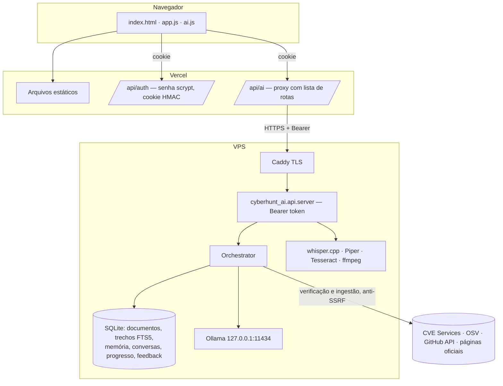

# Arquitetura

## Componentes



## Fronteiras de confiança

| Fronteira | Controle |
|---|---|
| Internet → Vercel | Login com senha (hash scrypt), cookie HttpOnly/Secure/SameSite=Strict assinado, verificação de Origin em escrita, limitação de tentativas |
| Vercel → VPS | HTTPS (Caddy), token Bearer de 48+ caracteres, apenas rotas da lista |
| API → Ollama | Somente 127.0.0.1; Ollama nunca exposto |
| Documentos/código → modelo | Tratados como dados; delimitados em `<fonte>`; detector de injection |
| Modelo → sistema | O modelo não tem ferramentas: não executa comandos, não grava memória, não envia nada. Binários de mídia recebem argumentos fixos, sem shell |
| API → internet | Apenas http/https para destinos públicos (bloqueio de IPs privados, inclusive após redirect) |
| Processo na VPS | systemd com usuário dedicado, `ProtectSystem=strict`, `NoNewPrivileges`, escrita só em `/var/lib/cyberhunt-ai`, limite de memória |

## Estrutura do SDK

```
vps/cyberhunt_ai/
├── config.py              variáveis de ambiente
├── db.py                  esquema SQLite (FTS5)
├── core/                  orchestrator.py (pipeline), model_router.py (modelo por tarefa, capacidades reais)
├── providers/             ollama.py, llamacpp.py (sem fallback que finja respostas)
├── knowledge/             ingestion.py (procedência, SHA-256, PDF/HTML), retrieval.py (BM25 + embeddings, RRF)
├── memory/                store.py (categorias, progresso com evidência, exportação), conversation.py (perguntas paralelas)
├── verification/          identifiers, source_verifier, claim_validator, injection, cwe_catalog, net (anti-SSRF), labels
├── multimodal/            local_media.py (STT, TTS, OCR)
├── specialists/           prompts.py (11 modos, versionados)
├── evaluations/           cases.json, runner.py
├── training/              dataset.py (JSONL para fine-tuning futuro)
└── api/                   server.py
```

A estrutura sugerida no pedido (um arquivo por especialista, `context_manager.py`, etc.) foi condensada: os especialistas são modos de prompt no mesmo pipeline, o que evita duplicar código e mantém uma única camada de verificação para todos.

## Modelo de dados (resumo)

- `documents` — título, URL, coleção, tipo, licença, versão, SHA-256, HTTP, data de coleta, procedência, sinais de injection.
- `chunks` + `chunks_fts` — trechos indexados (BM25) e embedding opcional.
- `memories` — learning, professional, research, preferences, corrections.
- `conversations` (com `parent_id` para perguntas paralelas) e `messages` (com metadados de verificação, fontes, modelo, versão do prompt).
- `progress` — not_started → studying → practiced → demonstrated (os dois últimos exigem evidência).
- `feedback` — avaliação e correção da pesquisadora.

## Escolha de SQLite em vez de PostgreSQL + pgvector

Para uma usuária e alguns milhares de trechos, SQLite com FTS5 dispensa um serviço a mais na VPS de 8 GB. A comparação de embeddings é feita em memória com numpy. Se a base crescer para centenas de milhares de trechos, migrar para PostgreSQL + pgvector exige trocar `db.py` e `retrieval.py`, sem mudar a API.
